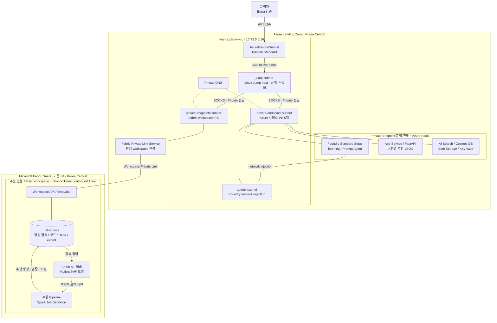
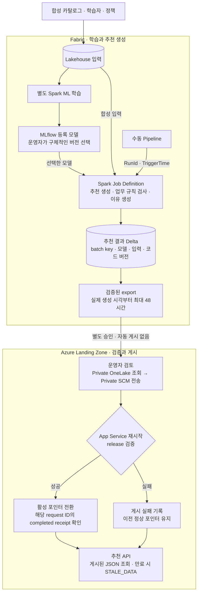
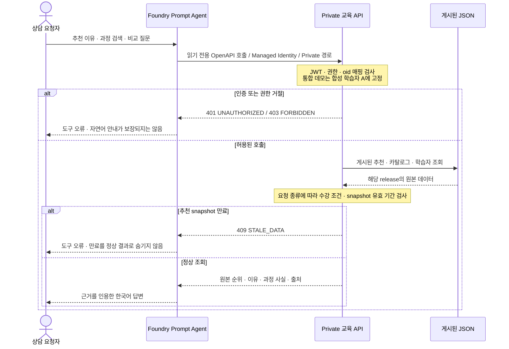

# Azdemy — Azure 기반 개인화 학습 추천·상담 데모

Personalized learning recommendations and grounded consultation with Microsoft Fabric and Microsoft Foundry.

직원의 직무·역량·학습 이력에 맞춘 교육 추천과 읽기 전용 교육 상담을 시연하는 프로젝트입니다. Microsoft Fabric에서 추천 결과를 배치로 생성하고, Azure의 Private API가 검증된 결과를 조회합니다. Microsoft Foundry Agent Service의 Prompt Agent는 이 API를 호출해 추천 이유를 설명하고 교육 과정을 비교합니다.

**업무 데이터 서비스를 공개하지 않고, Private Endpoint와 Private DNS를 사용해 추천 조회·결과 게시·상담 도구 호출을 구성합니다.** 저장소에는 인프라의 Bicep 코드, 추천 배치, API와 상담 에이전트 코드가 포함되어 있습니다. Private 접근 구성은 완전한 인터넷 차단과 다르며, 국내 처리·저장 요건은 별도 검토가 필요합니다.

모든 교육 과정·학습자·학습 이력은 합성 데이터입니다. 실제 직원 정보나 외부 교육기관의 과정 설명은 사용하지 않습니다. 기능 범위와 설계 조건은 [요구사항 정의서](docs/requirements.md)를 기준으로 합니다.

## 목차

- [프로젝트 개요](#프로젝트-개요)
- [Azure 인프라 아키텍처](#azure-인프라-아키텍처)
- [Private 환경 구성](#private-환경-구성)
- [추천 생성과 서비스 흐름](#추천-생성과-서비스-흐름)
- [API와 상담 계약](#api와-상담-계약)
- [저장소 구성](#저장소-구성)
- [로컬 실행](#로컬-실행)
- [Azure 배포와 Fabric 실행](#azure-배포와-fabric-실행)
- [검증](#검증)
- [현재 제한과 후속 과제](#현재-제한과-후속-과제)
- [운영과 정리](#운영과-정리)
- [상세 문서](#상세-문서)

## 프로젝트 개요

**Azdemy**의 `Az`는 Azure를 뜻합니다. 저장소 이름은 `azdemy-rec-demo`입니다.

이 데모는 추천 생성과 자연어 상담의 책임을 분리합니다. 추천 순위는 Fabric 배치가 결정하고, 추천 이유는 데이터 근거와 버전별 템플릿으로 생성합니다. 상담 에이전트는 게시된 순위와 이유를 그대로 설명하며, 별도의 공식 추천 순위를 만들지 않습니다.

프로젝트 코드는 [MIT License](LICENSE)로 공개합니다. 인프라 참고 코드의 출처와 라이선스는 [제3자 고지](infra/THIRD-PARTY-NOTICES)를 참고하세요.

| 시연 항목 | 구현 방식 |
|---|---|
| 본인 추천 조회 | 인증된 호출 주체를 합성 학습자에 매핑하고 게시된 추천 snapshot 조회 |
| 신규 학습자 처리 | 학습 이력이 부족하면 직무별 cold-start 정책 적용 |
| 수강 가능 여부 | 수료·직무 자격·필수 선수 과정·모집 기간·마감·폐강 검사 |
| 추천 이유 설명 | 추천 데이터의 이유 원문과 `reason_source_ref` 사용 |
| 과정 검색·비교 | 합성 카탈로그의 과정 사실과 `source_ref` 인용 |
| 오류 구분 | 권한 부족·검색 0건·추천 없음·데이터 만료·시스템 오류를 별도 상태로 표현 |

### 구현 범위

| 구분 | 현재 범위 |
|---|---|
| Azure 인프라 | VNet, Private Endpoint, Private DNS, Bastion, Jump host, Private App Service |
| 교육 상담 | Foundry Prompt Agent, 모델 추론, 읽기 전용 OpenAPI 도구, Managed Identity 인증 |
| 추천 생성 | 전용 Fabric workspace, Lakehouse Delta, Spark ML 학습, MLflow 등록, 수동 Spark 배치 |
| 결과 게시 | 검증된 export를 Private SCM으로 전송하고 버전별 JSON 활성화 |
| 데모 Serving | 기존 App Service의 지속 저장 영역 사용. 별도 production Serving DB 없음 |
| 합성 데이터 | 6개 카테고리의 교육 30개, 학습자 2명, 학습 이력·직무 정책 |
| 미통합 원천 | 사내 교육·인사 시스템, 실제 직원 인증과 최종 사용자 OBO |
| 로컬 회귀 fixture | 정적 추천 snapshot, cold-start·만료·장애 등 테스트 시나리오 |

별도 웹 UI는 없습니다. API와 Foundry 상담 호출, Fabric UI의 수동 Pipeline 실행을 중심으로 시연합니다.

## Azure 인프라 아키텍처

### Landing Zone과 Fabric의 영역 구분

아키텍처는 Azure Landing Zone의 애플리케이션·연결 영역과 Fabric의 데이터·추천 생성 영역으로 나눕니다. 여기서 Landing Zone은 이 데모의 Azure 배치 영역을 뜻합니다. 조직 전체의 관리 그룹, Hub-Spoke, 방화벽, ExpressRoute 등을 배포하는 완성형 Enterprise Landing Zone 템플릿은 아닙니다.

Fabric은 고객 VNet에 설치하는 서비스가 아니라 SaaS입니다. Fabric workspace에 접근하는 Private Endpoint는 Azure VNet에 두고, Lakehouse·Spark·MLflow는 Fabric 서비스 영역에서 실행합니다.



도식의 Azure 자원명은 다음 배포용 Bicep 기준이며, 새 환경은 아직 배포하지 않았습니다. Fabric workspace는 기존 리소스를 유지하며, 도식에는 실제 이름 대신 용도를 표시합니다.

이 도식의 화살표는 작업 흐름, 방향 없는 선은 연결 관계, 점선은 DNS 연결을 나타냅니다. 서비스 인증에는 Entra ID·Managed Identity와 서비스별 RBAC를 적용합니다. PaaS 자체가 `private-endpoints` subnet에 배치된다는 뜻은 아니며, 해당 subnet에는 서비스 접근용 네트워크 인터페이스가 생성됩니다. Fabric 내부 Spark 실행은 고객 VNet 안의 실행이나 Fabric outbound 격리를 의미하지 않습니다.

### Azure Landing Zone 영역

| 계층 | 구성 | 역할 |
|---|---|---|
| 네트워크 | VNet, subnet, NSG, NAT Gateway | Private 연결과 운영자 접근 기반 |
| 관리 접속 | Bastion Standard, Linux Jump host | 공개 IP 없는 VM에 SSH 접속하고 SOCKS 사용 |
| 상담 | Foundry Standard Setup, `learning` project | Prompt Agent와 Private 도구 호출 실행 |
| API | Linux App Service B1, Python 3.12, FastAPI | 인증·권한 검사, 추천 조회, 과정 검색·상세 조회 |
| 추천 Serving | App Service의 `/home/data/genius-recommendations` | 검증된 release와 활성·직전 정상 버전 보관 |
| Foundry 종속 서비스 | AI Search Basic, Cosmos DB Serverless, Blob Storage | Standard Setup의 BYO 서비스. 추천 Serving DB와 구분 |
| 비밀정보 관리 기반 | Key Vault, 서비스별 Managed Identity·RBAC | keyless 접근을 위한 인프라 구성 |

현재 상담은 OpenAPI로 카탈로그를 조회합니다. AI Search를 별도의 교육 콘텐츠 검색 인덱스로 사용한다고 설명하지 않으며, Cosmos DB나 Blob Storage에도 추천 Serving 데이터를 적재하지 않습니다.

| Subnet | 주소 | 용도 |
|---|---|---|
| `agents` | `10.72.0.0/24` | `Microsoft.App/environments` delegation, Foundry network injection |
| `private-endpoints` | `10.72.1.0/24` | Azure PaaS와 Fabric workspace의 Private Endpoint |
| `jump` | `10.72.2.0/24` | Jump host, NSG, NAT outbound |
| `AzureBastionSubnet` | `10.72.3.0/26` | Bastion |

기존 사내망이나 다른 VNet과의 peering은 구성하지 않았습니다. 사내 연결을 추가할 때는 주소 충돌, 라우팅, DNS 전달과 허용할 인증 경로를 별도로 검토해야 합니다.

### Fabric 영역

전용 workspace는 기존 F4 capacity에 배정합니다. 새 capacity를 만들거나 production Serving 서비스를 추가하는 구조가 아닙니다. 합성 입력과 모델·코드 버전을 고정한 뒤 추천 결과를 생성합니다.

| 구성 | 현재 구현 |
|---|---|
| 입력 | 교육 카탈로그·학습자·정책 JSON, 입력별 SHA-256 기록 |
| 학습 | Spark ML의 TF-IDF·정규화 feature와 cosine 유사도 기반 콘텐츠 추천 |
| 모델 관리 | MLflow 실험과 `genius-content-baseline` 등록 모델 |
| 수동 실행 | Pipeline이 Spark Job Definition activity 하나 실행 |
| 실행 주체 | 전용 Workspace Identity와 `genius-rec-demo-spark-wi` connection |
| 원본 결과 | Lakehouse Delta `genius_recommendations`, `batch_key`별 보관 |
| 게시용 결과 | `Files/batches/<batch key>/export`의 완성된 JSON bundle |
| API 반영 | 운영자가 별도로 검증·게시. Pipeline의 자동 게시 없음 |

현재 수동 Pipeline에는 Notebook activity가 없습니다. 학습 Notebook은 별도로 유지하고, 기존 배치 Notebook은 복구·운영자 실행 경로로 남깁니다. 자동 재학습·실행 예약·API 자동 게시도 포함하지 않습니다.

Azure 기본 인프라는 [main.bicep](infra/main.bicep), Fabric 연결용 Azure 자원은 [fabric-private.bicep](infra/fabric-private.bicep)에서 관리합니다. Fabric workspace·모델·Pipeline 구성은 [Fabric 운영 코드](fabric/)에서 관리하므로 기본 Bicep 배포 한 번으로 전체 구성이 끝나지는 않습니다.

## Private 환경 구성

### 업무 데이터의 Private 접근 경로

**현재 구현은 업무 데이터의 inbound 공개 접근을 차단하고, 허용된 네트워크와 identity에서만 조회·게시하는 방식입니다.** Private Endpoint만 생성하는 데 그치지 않고 public access 차단, DNS 해석, TLS 연결과 외부 차단을 각각 검증한 기록이 있습니다.

| 연결 구간 | 구성 방식 |
|---|---|
| 운영자 → Jump host | Bastion native tunnel과 SSH 공개키 인증. VM 공개 IP 없음 |
| 운영자 → Private 서비스 | SSH SOCKS5, 프록시 쪽 DNS 해석, 원래 hostname의 HTTPS 인증서 검증 |
| 클라이언트 → Foundry | Foundry account Private Endpoint, public access 차단 |
| Foundry → 교육 API | Agent subnet network injection과 App Service Private Endpoint |
| Foundry → BYO 서비스 | Search·Cosmos·Blob 등의 Private Endpoint와 RBAC |
| 운영자 → Fabric API·OneLake | workspace 전용 Private Link와 Private DNS |
| 운영자 → API 코드·결과 게시 | App Service Private SCM, Entra 인증, basic publishing 인증 차단 |

템플릿 구성은 기본 Azure 서비스의 Private Endpoint 6개·Private DNS zone 8개에 Fabric용 Private Endpoint 1개·`privatelink.fabric.microsoft.com` zone을 추가하는 형태입니다. Fabric 공개 접근 차단은 전용 workspace의 inbound 정책에만 적용하며, tenant 전체나 다른 workspace의 정책을 변경하지 않습니다.

Fabric Items·OneLake와 Azure API는 Private 경로로 접근합니다. API는 네트워크 접근과 별도로 인증을 검사하며, 외부 직접 접근은 차단합니다. 접속 방법은 [Private 인프라 가이드](infra/README.md)를 참고하세요.

### Private 구성의 범위와 예외

현재 구성은 완전한 air-gapped 환경이 아닙니다. Bastion 관리 접속과 Jump host의 NAT outbound에는 공개 IP가 있습니다. Entra 인증·서명 키 조회와 Azure 관리 API 등 필요한 인증·관리 의존성도 업무 데이터 서비스의 Private Endpoint와 구분해야 합니다.

Fabric workspace의 inbound는 `Deny`, outbound는 기존 `Allow`입니다. Fabric 내부 Spark가 고객 VNet의 Private Endpoint를 경유한다고 설명하지 않으며, 외부 통신까지 격리됐다고 주장하지 않습니다. 원천 수집에 필요한 VNet Data Gateway·Dataflow Gen2 등은 후보일 뿐 현재 배포된 구성은 아닙니다.

| 항목 | 현재 상태와 해석 |
|---|---|
| 업무 데이터 서비스 공개 접근 | Azure 서비스 public access 차단, Fabric 전용 workspace inbound 차단 |
| 서비스 인증 | Managed Identity·Entra·RBAC 사용. API key·SAS·Storage Shared Key로 우회하지 않음 |
| Fabric outbound 격리 | 미구현·미검증. inbound Private Link와 별개 |
| 사내 사용자 접속 | 데모는 Bastion·SOCKS 사용. production 접속 방식은 별도 결정 |
| 국내 처리·저장 | 전체 준수 미입증. 아래 데모 예외 적용 |

데모는 Korea Central의 Azure 자원과 Fabric capacity를 사용하지만, Foundry 모델은 승인된 `gpt-5.6-terra` GlobalStandard입니다. Fabric tenant home region은 West US 3이고, 조직 정책의 중앙 Log Analytics는 West US 2에 저장됩니다. 이 예외는 합성 데이터 데모에 한해 승인됐습니다. Private 연결이나 국내 capacity만으로 SEC-01~03의 국내 처리·저장 준수를 단정하면 안 됩니다.

## 추천 생성과 서비스 흐름

### 학습·배치·게시의 분리



추천 API는 요청마다 Spark 작업을 실행하거나 OneLake를 조회하지 않습니다. 게시된 JSON만 읽으므로 Fabric capacity를 중지한 상태에서도 유효 기간 안의 추천을 조회할 수 있습니다.

### 버전과 실패 처리

일반 추천은 최대 3개이며 의무교육은 별도 목록으로 반환합니다. 학습 이력이 부족한 사용자는 직무별 cold-start 정책을 사용합니다. API 장애나 개인화 결과 누락을 cold-start로 숨기지는 않습니다.

결과에는 실제 생성 시각, 유효 기간, 모델·정책·입력·코드 버전과 실행 근거를 남깁니다. 유효 기간은 실제 생성 시각부터 최대 48시간이며, 같은 실행을 재시도하거나 다시 게시해도 늘어나지 않습니다. Pipeline은 RunId를 batch key로 사용하고 TriggerTime을 업무 규칙의 기준 시각으로 전달합니다.

게시 시 스키마·참조·checksum·추천 이유를 검사하고 완성된 release만 활성화합니다. 실패하면 기존 정상 포인터를 유지하며, 이전 버전도 만료되면 `STALE_DATA`를 반환합니다. 이전 정상 버전으로의 rollback은 명시적인 운영 작업입니다.

현재 게시 절차에는 App Service 재시작이 포함됩니다. 버전 전환의 일관성은 검사하지만 무중단 배포는 아닙니다.

### 읽기 전용 상담



권한과 수강 가능 여부는 API가 판단합니다. 에이전트 지시문만으로 권한을 통제하지 않습니다. 과정 설명과 도구 결과에 포함된 문장은 데이터로 취급하며, 에이전트의 권한이나 실행 정책을 바꿀 수 없습니다.

## API와 상담 계약

### 읽기 전용 도구

| Operation | 경로 | 용도 |
|---|---|---|
| `getMyRecommendations` | `GET /recommendations/me` | 본인 추천·이유·원본 순위·버전·생성 시각·의무교육 |
| `searchCourses` | `GET /courses/search` | `query`, `category`, `language`, `limit` 조건의 검색 |
| `getCourses` | `GET /courses?ids=SYN-DEV-001,SYN-DEV-002` | 최대 5개 과정의 상세 사실과 수강 가능 여부 |

API는 JWT의 RS256 서명, tenant, issuer, audience, 만료와 필수 claim을 검증합니다. `Learner.Read` 앱 역할 또는 `access_as_user` 위임 scope를 확인한 뒤, 허용된 `oid → 학습자` 매핑을 적용합니다. 임의 직원 ID나 scenario parameter는 허용하지 않습니다.

실제 통합 상담에서는 확인된 Foundry account Managed Identity 하나를 합성 학습자 A에 고정합니다. 이 identity를 project identity나 Workspace Identity와 혼용하지 않습니다. 위임 scope 검사 코드가 있어도 최종 사용자 OBO와 개인별 직원 매핑이 완성된 것은 아닙니다. Cold-start 학습자 B는 로컬 테스트에서 검증합니다.

과정 사실에는 `source_ref`, 추천 이유에는 `reason_source_ref`를 사용합니다. 에이전트는 원본 순위와 이유를 보존하며, 과정 검색으로 찾은 대안을 공식 추천처럼 재번호화하지 않습니다. 강사·가격 등 원본에 없는 사실은 확인할 수 없다고 안내합니다.

### 상태와 오류

| 상황 | HTTP | 응답 |
|---|---:|---|
| 정상 조회 | 200 | `status=OK` |
| 유효한 검색의 0건 결과 | 200 | `status=NO_RESULTS`, `items=[]` |
| 알 수 없는 과정 ID·추천 0건 | 404 | `error.code=NO_RESULTS` |
| 토큰 없음·만료·잘못된 인증 | 401 | `UNAUTHORIZED` |
| 권한 부족·허용되지 않은 호출 주체 | 403 | `FORBIDDEN` |
| 만료되거나 미래에 생성된 snapshot | 409 | `STALE_DATA` |
| 잘못되거나 중복된 parameter | 422 | `INVALID_REQUEST` |
| 일시적 데이터·인증 키 장애 | 503 | `SYSTEM_ERROR` |
| 예상하지 못한 내부 오류 | 500 | `SYSTEM_ERROR`, request ID |

현재 Foundry OpenAPI 실행 경로는 일부 non-2xx 응답에서 `tool_user_error` 또는 `tool_server_error`로 상담을 중단합니다. 모든 API 오류가 자연어 안내로 변환되는 것은 아닙니다. 호출 측에서도 이 실패를 빈 추천 목록이나 성공 응답으로 숨기면 안 됩니다.

## 저장소 구성

| 경로 | 내용 |
|---|---|
| [api/](api/) | FastAPI 경로, Entra JWT 인증, 데이터 계약, snapshot 조회와 게시 처리 |
| [agent/](agent/) | Prompt Agent 지시문·정의 생성, 게시·호출, 응답 근거 검증 |
| [azdemy_recommendations/](azdemy_recommendations/) | API·Spark가 공유하는 제외 규칙·추천 이유·배치 로직 |
| [fabric/](fabric/) | 학습·배치 Notebook, Spark 진입점, Pipeline 정의, 운영자 CLI |
| [infra/](infra/) | Bicep, Private 접속, API 패키징·게시, 인프라 검증 |
| [data/](data/) | 합성 교육·학습자·정책·정적 추천 fixture |
| [tests/](tests/) | API·데이터·추천·게시·Fabric 운영 계약의 회귀 테스트 |
| [docs/](docs/) | 요구사항과 API·상담 실행 가이드 |
| [requirements.txt](requirements.txt) | FastAPI·Pydantic·PyJWT·Uvicorn 런타임 의존성 |
| [requirements-dev.txt](requirements-dev.txt) | 런타임 의존성과 HTTP 테스트 클라이언트 |
| [AGENTS.md](AGENTS.md) | 개발 범위·안전·검증 원칙 |

## 로컬 실행

### 사전 준비

명령은 Windows PowerShell에서 저장소 루트를 기준으로 실행합니다. Azure 배포 대상은 Linux Python 3.12이며, 로컬 개발·테스트 환경은 Python 3.14입니다. Azure/Fabric 작업에는 Azure CLI, Bicep, SSH, `curl.exe`와 해당 작업의 Entra·RBAC 권한이 필요합니다. 로컬 테스트만 실행할 때는 Azure 자원이나 로그인 없이 진행할 수 있습니다.

처음 구성할 때 가상환경을 만들고 개발 의존성을 설치합니다. 기존 가상환경이 있으면 생성 단계는 생략합니다.

```powershell
python -m venv .venv
.\.venv\Scripts\python -m pip install -r .\requirements-dev.txt
.\.venv\Scripts\python -m unittest discover -s .\tests -v
```

테스트는 서명된 로컬 JWT, 고정 시계와 의존성 교체를 사용합니다. 실제 Entra나 Fabric에 요청하는 통합 시험을 대신하지는 않습니다.

### API 기동

아래 placeholder를 실제 허용된 tenant·API 앱·호출 주체의 UUID로 바꿉니다. 환경변수는 현재 PowerShell 프로세스에만 적용되며 토큰이나 client secret을 입력하는 항목이 아닙니다.

```powershell
$env:AZDEMY_TENANT_ID = '<tenant-id>'
$env:AZDEMY_API_CLIENT_ID = '<api-application-client-id>'
$env:AZDEMY_PRINCIPAL_LEARNERS = '{"<allowed-principal-object-id>":"learner-a"}'

.\.venv\Scripts\python -m uvicorn api.main:app --host 127.0.0.1 --port 8000
```

실제 조회에는 해당 audience·role 또는 scope를 가진 Entra 액세스 토큰과 허용된 호출 주체 매핑이 모두 필요합니다. 인증을 생략하는 실행 모드는 없습니다. Swagger UI와 공개 OpenAPI 문서 endpoint도 비활성화되어 있으며, Agent 도구용 스키마는 코드에서 생성합니다.

`AZDEMY_PUBLICATION_ROOT`를 지정하지 않으면 [정적 합성 데이터](data/)를 읽습니다. 지정하면 해당 디렉터리의 활성 release를 사용하며, 게시 데이터가 없거나 손상됐을 때 정적 fixture로 자동 대체하지 않습니다.

정적 fixture의 유효 기간은 `2026-10-20T12:00:00Z`부터 `2026-10-22T12:00:00Z`까지입니다. 실제 API는 현재 UTC 시각을 사용하므로 기간이 지난 뒤 추천 조회가 `STALE_DATA`로 끝나는 것은 의도한 동작입니다. 테스트 통과를 위해 fixture 날짜를 바꾸거나 실행 시 TTL을 자동 연장하지 않습니다.

## Azure 배포와 Fabric 실행

### 배포 순서

2026-10-22 기존 데모 RG `rg-genius-rec-demo-krc`를 삭제했습니다. 다음 배포의 RG는 `rg-azdemy-rec-demo-krc`이며 Bicep 자원명·태그도 `azdemy`를 사용합니다. 새 환경은 아직 배포하지 않았습니다. 이 문서의 기존 구성·검증 결과는 과거 실행 기록이며, 삭제한 API·Foundry·VNet에 현재 접속할 수 있다는 의미가 아닙니다.

운영 명령에는 [배포 출력값](infra/README.md#빌드와-배포)의 `$ApiName`, `$ApiUrl`, `$ProjectEndpoint`와 새 Agent 버전을 전달합니다. API 환경변수는 `AZDEMY_*`이며 기존 `GENIUS_*` 설정은 사용하지 않습니다. 공용 Fabric capacity와 기존 workspace·Delta 테이블 `genius_recommendations`·게시 저장 경로는 유지합니다.

다른 구독이나 tenant에서 실행하려면 Bicep parameter뿐 아니라 [Fabric 운영 코드](fabric/run.py)의 고정 구독·capacity·RG와 권한도 검토해야 합니다. 범용 원클릭 배포 템플릿으로 사용하지 않습니다.

1. [승인 범위와 보안 조건](docs/requirements.md)을 확인하고 대상 구독·전용 RG·기존 capacity를 점검합니다.
2. [인프라 가이드](infra/README.md)에 따라 SSH 공개키와 parameter를 준비하고 Bicep 빌드·검사·what-if를 수행합니다.
3. 명시적인 승인 뒤 기본 Azure 인프라를 배포하고, Bastion·SOCKS와 Private DNS·외부 차단을 확인합니다.
4. [API 가이드](docs/demo-api.md)에 따라 Entra API 앱·조회 역할·실제 tool caller 매핑을 구성하고 API·Prompt Agent를 게시합니다.
5. [Fabric 가이드](fabric/README.md)에 따라 전용 workspace와 별도 Private Link 자원을 구성하고 inbound 차단을 검증합니다.
6. 합성 입력을 적재하고 모델 학습·버전 검토를 마친 뒤, Workspace Identity·Spark connection·수동 Pipeline을 구성합니다.
7. 배치 결과를 검증·게시하고 실제 API payload와 상담 답변을 원본 export에 대조합니다.

기본 템플릿의 로컬 검사 명령은 다음과 같습니다. 실제 배포 명령과 필수 parameter는 [인프라 가이드](infra/README.md#빌드와-배포)를 따릅니다.

```powershell
az bicep build --file .\infra\main.bicep --outfile "$env:TEMP\azdemy-infra-compiled.json"
az bicep lint --file .\infra\main.bicep
python .\infra\tests\validate_template.py "$env:TEMP\azdemy-infra-compiled.json"
```

### 기존 Fabric Pipeline의 수동 실행

Private 접속과 capacity 실행 승인을 확인한 상태에서 `ws-genius-rec-demo`의 `genius-recommendation-batch` Pipeline을 열고 **Run**을 선택합니다. `Generate_and_validate_recommendations` activity 하나가 Spark Job Definition을 실행합니다.

완료 후 Pipeline의 `Completed`, activity의 `Succeeded`와 `Files/batches/<Pipeline RunId>/export`를 확인합니다. Delta 테이블은 여러 실행을 함께 보관하므로 조회 시 `batch_key`를 해당 RunId로 제한해야 합니다. 이 실행은 모델을 재학습하거나 API의 활성 버전을 바꾸지 않습니다.

Spark Job Definition을 필요한 인자 없이 직접 실행하지 않습니다. 초기 학습·Notebook 기반 운영자 명령과 현재 native Spark Pipeline은 실행 경로가 다르므로 [Fabric 가이드](fabric/README.md)의 해당 절차를 구분해서 사용합니다.

### 결과 게시와 상담 호출

게시 명령은 Private 터널과 실행 이력이 담긴 기존 state가 준비된 운영자용 절차입니다. `$State`는 저장소 밖의 실행 inventory JSON, `$Export`는 그 실행에서 검증한 export 디렉터리입니다. 새 Pipeline 실행 결과라면 먼저 해당 실행과 export를 확인해야 하며, 이전 state를 그대로 사용해 새 결과라고 게시하면 안 됩니다.

```powershell
.\infra\publish-snapshot.ps1 -State $State -Export $Export -ApiName $ApiName
```

게시 성공은 파일 전송이나 앱 재시작만으로 판단하지 않습니다. 서버의 해당 request ID receipt가 `completed`인지 확인해야 하며 위 스크립트가 이 확인까지 수행합니다. rollback도 [별도 게시 절차](fabric/README.md#게시와-실패-처리)를 따릅니다.

아래 예시는 새 배포의 `$ProjectEndpoint`와 게시 응답의 `$AgentVersion`을 사용합니다.

```powershell
.\agent\invoke.ps1 -ProjectEndpoint $ProjectEndpoint -AgentVersion $AgentVersion -Message '내 추천 교육과 추천 이유를 알려줘.' -OutputFile "$env:TEMP\azdemy-response.json"
.\agent\invoke.ps1 -ProjectEndpoint $ProjectEndpoint -AgentVersion $AgentVersion -Message 'SYN-DEV-001과 SYN-DEV-002를 비교해줘.' -OutputFile "$env:TEMP\azdemy-comparison.json"
```

snapshot이 만료됐거나 Private 접속이 끊긴 상태에서는 정상 상담을 기대하지 않습니다. 오류를 숨기지 않고 유효한 신규 배치와 접속 상태를 확인해야 합니다.

## 검증

### 로컬 회귀 검사

```powershell
.\.venv\Scripts\python -m unittest discover -s .\tests -v
.\.venv\Scripts\python -m compileall -q .\api .\agent .\fabric .\azdemy_recommendations
```

| 요구사항 | 검사 범위 |
|---|---|
| REC-01~05 | 본인 매핑, 원본 순위·이유, 수강 제외 규칙, cold-start 정책 |
| AGT-01~06 | 도구 계약, 과정 사실·근거, 추천 이유 보존, 권한·오류 상태 |
| DAT-02 | ID·참조·카테고리·직무·선수 과정 무결성 |
| MOD-01·05 | 모델·입력·코드 provenance와 배치 계약. Spark 학습은 Fabric 환경에서 별도 확인 |
| PIP-01~05 | 배치 재실행, export 무결성, release 활성화·rollback·유효 기간 |
| SEC-05·06 | JWT·권한·호출 주체 검사, keyless Agent 도구 정의 |

로컬 검사는 Spark·MLflow의 실제 실행, 네트워크 격리나 전체 국내 처리·저장 준수를 증명하지 않습니다.

### 데모 시나리오

Azure·Fabric 환경에서는 추천 생성부터 게시와 상담까지의 흐름을 확인합니다. API 응답과 상담 내용은 같은 버전의 추천 결과·교육 카탈로그를 기준으로 대조합니다.

| 시나리오 | 확인 범위 |
|---|---|
| 개인화 추천 | 원본 순위·추천 이유·근거 인용, 의무교육 분리 |
| 과정 탐색과 비교 | 과정별 수준·시간·선수 조건·언어·자막, 누락 정보의 확인 불가 안내 |
| 수강 조건 | 수료·마감·폐강·직무 자격·선수 과정에 따른 제외 |
| 권한과 오류 | 다른 학습자 조회 거절, 검색 0건 안내, 인증 검사와 외부 접근 차단 |
| 배치와 게시 | Native Spark 실행, export 검증, 버전별 게시와 Fabric 중지 후 조회 |

Cold-start·만료·강제 장애·다른 호출 주체의 JWT 거절은 로컬 회귀 검사와 export 재생으로 확인합니다. 이를 모든 오류를 실제 서비스에 주입한 시험으로 해석하면 안 됩니다. Playground의 브라우저 전체 흐름, 최종 사용자 OBO와 실제 직원 대상 추천 품질은 검증 범위에 포함하지 않습니다.

환경별 실행·확인 방법은 [Fabric 가이드](fabric/README.md), [API·상담 가이드](docs/demo-api.md), [Private 인프라 가이드](infra/README.md)를 참고하세요.

## 현재 제한과 후속 과제

| 항목 | 남은 범위 |
|---|---|
| 실제 데이터 연동 | 원천 소유자·수집 항목·이용 근거·증분 수집·삭제 전파 정의와 구현 |
| 최종 사용자 권한 | OBO·개인별 직원 매핑·에이전트별 production 권한 모델 |
| 모델 품질 | MOD-03·04의 시간 분리 평가, 기준 방식 비교와 실제 추천 품질 검증 |
| 모델 운영 | 품질 기준에 따른 정식 승인·승격·모델 rollback 체계. 현재 결과 release rollback과 구분 |
| Serving | production 저장소·성능·가용성·보존 정책 결정 |
| 네트워크 | 사내 접속, 원천별 Private 커넥터 지원, Fabric outbound 제어와 관리 의존성 검증 |
| 국내 처리 | SEC-01~03의 모델·메타데이터·로그·백업·관리 경로별 위치 검토 |
| 상담 오류 UX | Foundry non-2xx 도구 오류를 포함한 호출 측 실패 안내 |
| 피드백 | REC-06 피드백 수집은 현재 읽기 전용 데모에 미구현 |

Azure Machine Learning, 실시간 재학습·개인화, 수강 신청·취소, HR 정보 변경, 쓰기 가능한 Agent 도구와 다중 에이전트 오케스트레이션은 현재 범위에 포함하지 않습니다.

## 운영과 정리

시연 전후에는 Fabric capacity와 Jump host의 실행 상태를 확인합니다. 시연이 끝나면 [Fabric 운영 절차](fabric/README.md)에 따라 작업을 위해 재개한 자원을 중지합니다.

Fabric capacity 중지나 VM 할당 해제만으로 App Service·Bastion·Private Endpoint·디스크·저장소 등의 요금이 모두 중단되지는 않습니다. 유지할 자원과 비용을 별도로 확인해야 합니다.

`expiresOn` 태그는 정리 검토 시점을 나타내며 자동 삭제 예약이 아닙니다. 프로젝트 전용 RG를 삭제할 때는 자원 목록과 종속성을 먼저 확인하고, 공용 Fabric capacity와 중앙 로그 자원을 정리 대상에서 구분합니다. Entra 앱과 Fabric Workspace Identity·connection 등 RG 밖의 항목도 별도로 점검합니다.

토큰·client secret·connection string·SSH 개인키·실제 직원 데이터를 저장소에 기록하지 않습니다. 배포 parameter, 실행 state와 응답 검증 자료는 저장소 밖에서 관리합니다.

## 상세 문서

| 문서 | 내용 |
|---|---|
| [요구사항 정의서](docs/requirements.md) | REC·AGT·DAT·MOD·PIP·SEC 요구사항과 승인된 데모 예외 |
| [Private 인프라 가이드](infra/README.md) | Bicep 배포, Bastion·SOCKS, Private DNS·접근 차단, 비용·정리 |
| [Fabric 가이드](fabric/README.md) | 학습, 수동 Spark Pipeline, Delta·export, 게시·rollback |
| [API·상담 가이드](docs/demo-api.md) | 인증 경계, API 계약, 패키징·게시, 상담 호출과 검증 한계 |
| [합성 데이터 가이드](data/README.md) | 카탈로그 필드, 합성 작성 범위, 수강 조건과 테스트 시나리오 |
| [서드파티 고지](infra/THIRD-PARTY-NOTICES) | Foundry 인프라 예제의 출처·라이선스 |
